# Kurio — Marketplace de NFTs

[](https://github.com/Kaylan00/jungle-frontend-challenge/actions/workflows/ci.yml)

Solução do [desafio de frontend da Jungle Gaming](https://github.com/junglegaming/frontend-challenge): marketplace de NFTs com descoberta, compra e conta do colecionador, em desktop e mobile. A API REST e o Socket.IO são simulados com MSW na camada de rede; o app faz as mesmas chamadas que faria contra um backend real.

- **Aplicação publicada**: https://jungle-frontend-challenge-navy.vercel.app
- **Layout de referência**: [Figma](https://www.figma.com/design/Ff0SksUi7UFtPWUO8kyNtw/Frontend-Challenge?node-id=0-1)
- **Contratos, eventos, sessão, cache e desvios do Figma**: [ARCHITECTURE.md](./ARCHITECTURE.md)
- **Enunciado conferido item por item, com evidência**: [CHECKLIST_DESAFIO.md](./CHECKLIST_DESAFIO.md)
- **Auditoria Lighthouse**: [lighthouse/RESULTADOS.md](./lighthouse/RESULTADOS.md)
- **Segurança**: [SECURITY.md](./SECURITY.md)

## Credenciais fictícias

| Conta | E-mail | Senha | Para quê |
| --- | --- | --- | --- |
| Ana Colecionadora | `ana@kurio.test` | `Selva2026!` | Comprar: já tem carteira principal (Ethereum/MetaMask) e secundária (Polygon/Coinbase) e 2 favoritos |
| Bruno Pixel | `bruno@kurio.test` | `Pixel2026!` | Sem carteiras (testar o cadastro de carteira), 1 favorito |
| Kurio Admin | `admin@kurio.test` | `Kurio#Admin2026` | Painel administrativo em `/admin` (extra, ver abaixo) |

Cupons: `KURIO10` (10%), `GENESIS25` (25%) e `BLACK2025` (expirado). Qualquer outro código é inválido.

## Como avaliar em 5 minutos

Tudo abaixo funciona na URL publicada.

1. **Compra**: entre como Ana, abra o **Emerald Ape #042**, escolha a edição **1/50** e adicione ao carrinho. Aplique `KURIO10`, clique em **Conectar e finalizar**, depois **Conectar MetaMask**, **Revisar e confirmar compra** e **Confirmar compra**. A tela mostra “Processando pagamento” por cerca de 2,5 s e passa ao recibo confirmado quando chega o evento `order.updated`; o recibo é o snapshot do pedido.
2. **Falhas**: abra o painel de cenários (aba com um frasco na borda esquerda da tela, a meia altura) ou use `?mock=` na URL, por exemplo `/?mock=lento` (skeletons), `/?mock=catalogo-500` (erro e “Tentar novamente”) ou `/?mock=pagamento-recusado`. Com o Emerald Ape 1/50 no carrinho, **Mudar preço** no painel atualiza o carrinho e, com a revisão da compra aberta, trava a confirmação até **Atualizar revisão**. A lista completa está em [Como reproduzir os fluxos de falha](#como-reproduzir-os-fluxos-de-falha).
3. **Tempo real em duas abas**: na aba 1, abra `/admin` e entre como admin; na aba 2 (mesmo navegador), abra `/nft/nft-01?edicao=nft-01-ed-3`. Em **NFTs** → Emerald Ape #042 → **Edições** → **Editar** a 1/50, mude o preço e salve: a aba 2 atualiza sem recarregar.
4. **Painel admin**: **Visão geral** (números e “Últimos eventos” ao vivo), **Pedidos** (o pedido da Ana aparece ali), **Cupons** e busca global com **Ctrl+K**.
5. **Reset**: **Resetar tudo** no painel de cenários restaura dados, sessões, pedidos e cenário.

O cenário escolhido fica salvo no navegador. Para voltar ao normal sem apagar os dados, abra `/?mock=padrao`.

## Telas

Capturas das baselines da regressão visual (dados fixos da seed), desktop 1440 e mobile 390.

| Tela | Desktop | Mobile |
| --- | --- | --- |
| Início | 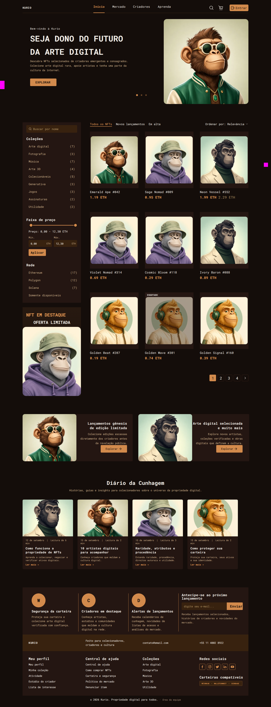 | 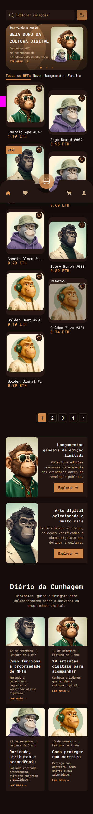 |
| Detalhe do NFT | 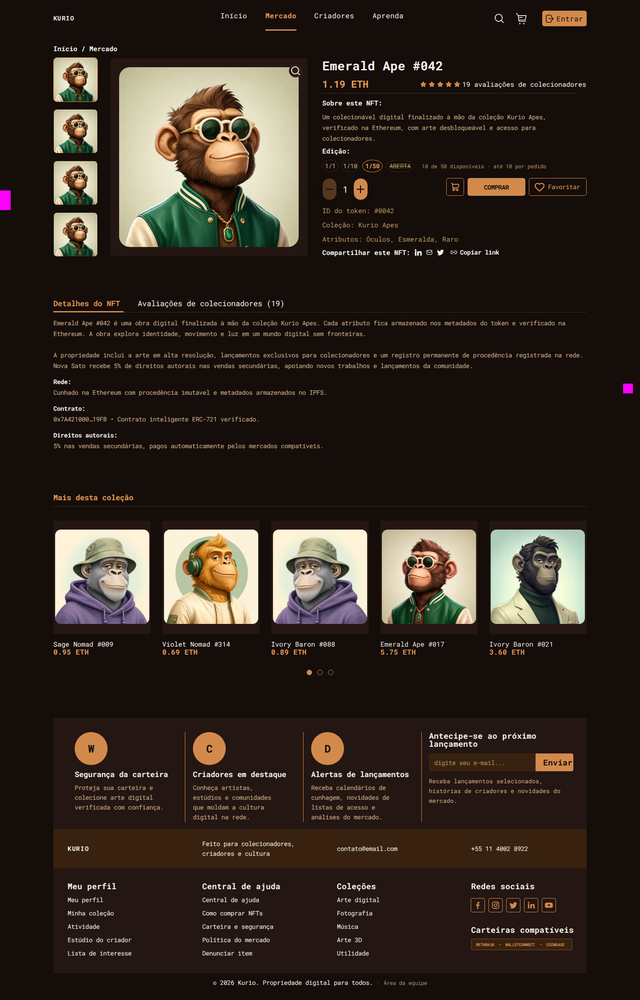 | 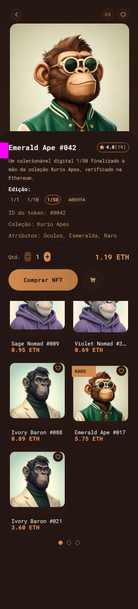 |
| Carrinho | 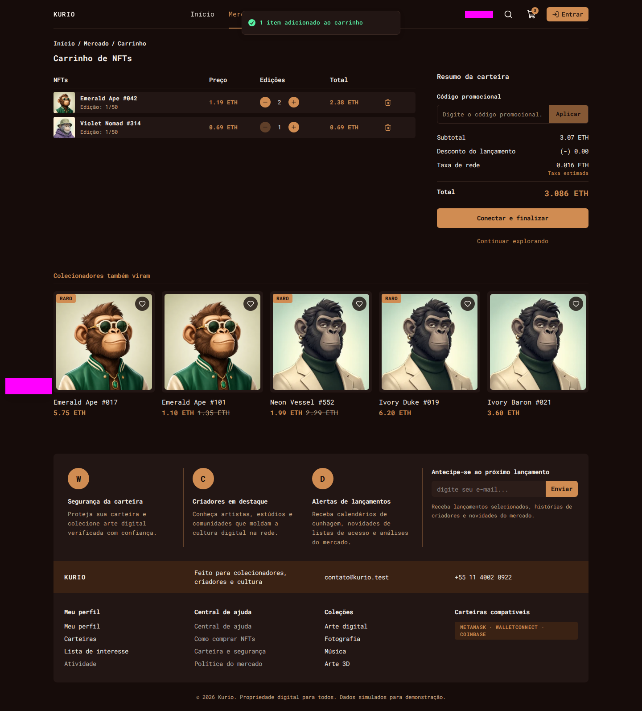 | 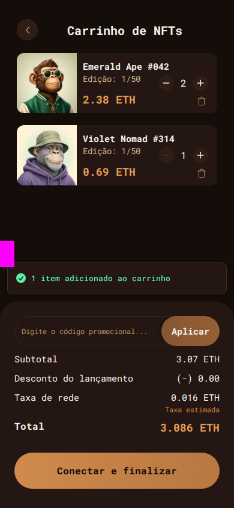 |
| Pagamento | 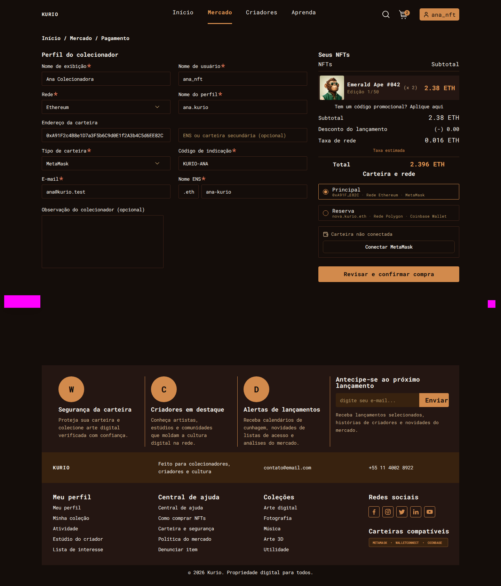 | 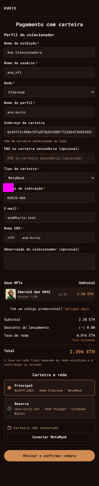 |

## Stack

| Exigida no enunciado | Usada |
| --- | --- |
| React + TypeScript | React 19, TypeScript 7 (build com Vite 8) |
| Roteamento | TanStack Router (rotas por arquivo, search params validados, guards) |
| Estado remoto | TanStack Query (consultas, mutations, atualização otimista com rollback) |
| Cliente HTTP / REST | Axios |
| Tempo real | `socket.io-client` |
| Estilo e componentes | Tailwind CSS 4, shadcn/ui (Radix) |
| Mocking | MSW 2 (REST) + `@mswjs/socket.io-binding` (Socket.IO) |
| E2E e regressão visual | Playwright |
| Auditoria | Lighthouse |

Complementares: zod (contratos), react-hook-form, decimal.js (valores em ETH), sonner (avisos), GSAP e Lenis (animações), Vitest (unitários), @axe-core/playwright, oxlint.

## Como rodar

Requisitos: **Node 22.12+** e npm. A CI usa Node 22. Dois comandos pedem um Node 22 mais recente: `npm run test:api` (22.18+, roda TypeScript direto) e `npm run lighthouse` (22.19+, exigência do Lighthouse 13).

A partir de um checkout limpo (é o que a CI faz; não depende de backend nem de serviço privado):

```bash
git clone https://github.com/Kaylan00/jungle-frontend-challenge.git
cd jungle-frontend-challenge
npm ci
npx playwright install chromium   # no Linux sem as bibliotecas do navegador: --with-deps chromium
npm run dev                        # http://localhost:5173, com mocks
```

| Comando | O que faz |
| --- | --- |
| `npm run dev` | Desenvolvimento com mocks |
| `npm run build` | Verificação de tipos + build de produção em `dist/` |
| `npm run preview` | Serve o build em http://localhost:4173, com os mesmos cabeçalhos de segurança do deploy |
| `npm run typecheck` | `tsc -b` (app, testes e a função `api/`) |
| `npm run lint` | oxlint em `src/`, `e2e/`, `api/` e `scripts/` |
| `npm run test:unit` | Vitest, sem navegador (`test:unit:watch` para o modo observação) |
| `npm run test:coverage` | Vitest com cobertura (relatório HTML em `coverage/`; a CI reprova abaixo dos limites) |
| `npm run test:api` | Teste isolado da função de e-mail `api/send-reset-email.ts`, sem rede e sem chave |
| `npm run test:e2e` | Playwright, desktop, tablet e mobile; sobe build + preview sozinho na porta 4173 |
| `npm run test:e2e:desktop` / `test:e2e:mobile` / `test:e2e:tablet` | Só um viewport |
| `npm run test:e2e:update` | Regrava as baselines visuais |
| `npm run test:e2e:report` | Abre o relatório HTML (com os traces das falhas) |
| `npm run lighthouse` | 5 medições por página e perfil, em HTTPS/HTTP2 local; rode `npm run build` antes |

## Variáveis de ambiente

O `.env` versionado não tem segredos e é igual ao `.env.example`:

| Variável | Valor | Uso |
| --- | --- | --- |
| `VITE_ENABLE_MOCKS` | `true` | Liga a camada de mocks (REST + Socket.IO). O build publicado usa `true` |
| `VITE_API_URL` | `/api` | Base da API REST |
| `VITE_SOCKET_URL` | `wss://realtime.kurio.mock` | Endereço do Socket.IO (interceptado pelo MSW) |

Opcionais, só do servidor (painel da Vercel, nunca em arquivo nem no navegador): `BREVO_API_KEY`, `BREVO_SENDER_EMAIL`, `BREVO_SENDER_NAME` e `PUBLIC_APP_URL`. Ligam o envio real do e-mail de recuperação de senha (ver [Além do pedido](#além-do-pedido-extras)). Sem elas, vale só o e-mail simulado. Detalhes em [ARCHITECTURE.md §4](./ARCHITECTURE.md#recuperação-de-senha).

## Cenários da simulação

Os cenários mudam o servidor simulado, nunca a interface. Três formas de escolher:

1. **Painel de cenários** (também no site publicado): presets e as ações **Mudar preço**, **Esgotar edição**, **Duplicar evento**, **Evento antigo**, **Derrubar socket**, **Desligar socket**, **Expirar sessão** e **Resetar tudo**. As ações de preço e estoque agem sobre a edição 1/50 do Emerald Ape #042.
2. **URL**: `?mock=<preset>` em qualquer página. Aceita combinações, como `/?mock=latency:variable,payment:reject`.
3. **Console ou testes**: `window.__jungleMock.setScenario({...})`.

O cenário fica no `localStorage` e sobrevive ao refresh. Cada preset (painel, `?mock=` ou `__jungleMock.applyPreset(nome)`) parte do cenário base inteiro: nada do cenário anterior continua valendo. **Reset**: **Resetar tudo** no painel ou `await window.__jungleMock.reset()` restaura a seed inteira (dados, sessões, pedidos e cenário). `?mock=padrao` volta só o cenário.

| Preset (`?mock=`) | Efeito |
| --- | --- |
| `padrao` | Latência normal, 150–400 ms (pseudoaleatória, semente fixa) |
| `rapido` | Sem latência |
| `lento` | 2,5 s por requisição |
| `latencia-variavel` | 100–1500 ms, reproduzível pela semente |
| `fora-de-ordem` | Latência variável e a busca do catálogo responde fora de ordem |
| `catalogo-500` | `GET /api/nfts` responde 500 |
| `sem-conexao` | Todas as rotas falham como “sem rede” |
| `pagamento-recusado` | O pagamento é recusado |
| `timeout-pedido` | O próximo pedido é criado, mas a resposta não chega ao cliente |
| `carteira-recusa` | A próxima conexão de carteira é recusada |
| `sessao-curta` | Sessões novas duram 60 s |
| `tempo-real-offline` | O servidor Socket.IO derruba as conexões e recusa as novas (ao religar, o cliente reconecta em até ~4 s) |
| `eventos-caoticos` | Cada `nft.updated` e `order.updated` chega três vezes: o original, uma duplicata (mesmo `eventId`) e uma versão antiga com dados absurdos (preço 999, pedido voltando a pendente). A tela aplica só o original |

## Como reproduzir os fluxos de falha

“Painel” é o painel de cenários. Os passos com carrinho usam o **Emerald Ape #042, edição 1/50**.

| Cenário do enunciado | Como reproduzir | O que acontece |
| --- | --- | --- |
| Sucesso | Cenário padrão: compra completa (roteiro acima) | Pedido confirmado pelo `order.updated` e recibo |
| Resultado vazio | Busque `zzzz` no catálogo | “Nenhum NFT encontrado” com “Limpar busca e filtros” |
| Carregamento lento | `?mock=lento` | Skeletons com shimmer no catálogo, detalhe e resumo do carrinho |
| Latência variável | `?mock=latencia-variavel` | Respostas entre 100 e 1500 ms, sempre na mesma sequência |
| Respostas fora de ordem | `?mock=fora-de-ordem` e digite rápido na busca | Só o resultado do último termo aparece |
| Sem conexão | `?mock=sem-conexao` | Mensagem de erro com “Tentar novamente” |
| HTTP 5xx | `?mock=catalogo-500` | Erro no catálogo com “Tentar novamente” |
| Falha em uma mutation | No console: `__jungleMock.setScenario({ faults: [{ route: 'PUT /api/favorites/*', kind: 'http500', times: 1 }] })` e favorite um NFT | O coração volta (rollback do otimista) com aviso. `kind`: `http500`, `http503`, `network` ou `timeout`; `times: -1` falha sempre |
| HTTP 404 | `/nft/nao-existe` ou `/qualquer-coisa` | “NFT não encontrado” / “Página não encontrada” |
| Sessão expirada | Logado, Painel → **Expirar sessão** e navegue (também no pagamento); ou `?mock=sessao-curta` e espere 60 s | Login com aviso e volta ao mesmo ponto, com o formulário de pagamento preservado |
| Acesso não autorizado | Sem login, abra `/perfil`; logado como Ana, abra `/admin` | Login com retorno ao endereço pedido; no painel, a mensagem do 403 da API |
| Conflito de cadastro | Crie conta com `ana@kurio.test` ou usuário `ana_nft` | O erro da API (409) aparece no campo correspondente |
| Validação de formulário | Cadastro, perfil, senha ou carteira com dados inválidos (ex.: endereço de carteira `0x123`) | Erros ligados aos campos, inclusive os devolvidos pela API |
| Cupom inválido ou expirado | `BLACK2025` (expirado) ou qualquer código inexistente | “Este cupom expirou” ou “Cupom inválido” no campo |
| Preço alterado no carrinho | Item no carrinho → Painel → **Mudar preço** | Aviso no carrinho e resumo recalculado |
| Cotação desatualizada no checkout | No pagamento: **Conectar MetaMask** → **Revisar e confirmar compra** → Painel → **Mudar preço** | A confirmação trava até **Atualizar revisão** |
| Servidor recusa cotação antiga | Igual ao anterior, mas clique em **Desligar socket** antes de **Mudar preço** | A API responde 409 e a revisão mostra os valores novos para confirmar de novo |
| Edição esgotada | Item no carrinho → Painel → **Esgotar edição** | “Edição esgotada: não entra no total” e **Conectar e finalizar** desabilitado |
| Timeout após criar o pedido | `?mock=timeout-pedido` e confirme a compra | Depois de 8 s o cliente reenvia com a mesma chave de idempotência e recebe o mesmo pedido; recarregar no meio também recupera |
| Clique repetido | Clique várias vezes em **Confirmar compra** | Um pedido só |
| Pagamento recusado | `?mock=pagamento-recusado` e compre | “Pagamento recusado”; os itens continuam no carrinho |
| Carteira recusa / desconexão | `?mock=carteira-recusa` e **Conectar** no pagamento; **Desconectar** depois de conectar | “Conexão recusada na carteira”; sem carteira conectada a revisão pede para conectar |
| Eventos duplicados ou antigos | No detalhe do Emerald Ape #042: **Mudar preço**, depois **Duplicar evento** e **Evento antigo** | O preço não volta ao valor antigo |
| Queda do tempo real | `?mock=tempo-real-offline` ou Painel → **Derrubar socket** | Indicador “Reconectando”; ao reconectar, os dados são conferidos pela REST |
| Eventos duplicados e antigos | `?mock=eventos-caoticos`, depois mude um preço (Painel ou `__jungleMock.changePrice('nft-01','nft-01-ed-3','1.40')`) | O preço vai para o valor novo e nunca mostra o 999 da versão antiga; nada é anunciado duas vezes |
| Pedido pendente sem conexão | Confirme uma compra e, ainda em “Processando pagamento”, Painel → **Desligar socket** e recarregue; depois **Ligar socket** | O estado vem da REST, sem criar outra compra |
| Link de redefinição de senha inválido, usado ou expirado | `/redefinir-senha?token=qualquer`, o mesmo link aberto de novo, ou `await __jungleMock.expirePasswordResets()` antes de abrir | Mensagem do motivo e “Pedir um novo link” |

## Estados de carregamento, erro e vazio

Toda tela que depende da API tem os três estados, no mesmo padrão visual do Figma:

- **Carregando**: skeleton com shimmer nas mesmas dimensões do conteúdo (`components/ui/skeleton.tsx` e os `*Pending`/`*Skeleton` de cada tela); CLS 0 no Lighthouse. Com movimento reduzido o shimmer para.
- **Erro**: `ErrorState` (`components/shared/error-state.tsx`) com a mensagem da API e "Tentar novamente"; falhas de mutation desfazem o otimista e avisam (`aria-live`). Reproduzir: tabela acima e `e2e/12`.
- **Vazio**: `EmptyState` (mesmo arquivo) com a ação que resolve, por exemplo "Limpar busca e filtros" no catálogo.

## Testes

**E2E (Playwright, Chromium)**: projetos `desktop` (1440×900), `mobile` (Pixel 7, 390×844) e `tablet` (768×1024, só os fluxos principais: catálogo, detalhe, carrinho, compra e carregamento), 24 arquivos de cenário + regressão visual. Cada teste começa com a seed limpa; os eventos chegam pelo `socket.io-client` e as respostas REST vêm dos handlers MSW.

| # | Cenário do enunciado | Arquivo |
| --- | --- | --- |
| 1 | Busca, filtros combinados, ordenação, paginação, histórico | `e2e/01-catalogo.spec.ts`, `e2e/14-filtros-ativos.spec.ts` |
| 2 | Acesso direto ao detalhe e recurso inexistente | `e2e/02-detalhe.spec.ts` |
| 3 | Cadastro, login, expiração de sessão, logout, troca de usuário | `e2e/03-conta-sessao.spec.ts` |
| 4 | Favoritos, falha de mutation e recuperação | `e2e/04-favoritos.spec.ts` |
| 5 | Carrinho, quantidades, remoção, cupom, persistência após refresh/login | `e2e/05-carrinho.spec.ts` |
| 6 | Compra completa, do catálogo ao recibo confirmado | `e2e/06-compra.spec.ts` |
| 7 | Pagamento recusado, clique repetido, timeout com o mesmo pedido | `e2e/07-falhas-pagamento.spec.ts` |
| 8 | Perfil, avatar, senha e carteiras com erros de validação | `e2e/08-perfil-carteiras.spec.ts` |
| 9 | Preço e disponibilidade via Socket.IO durante o checkout | `e2e/09-tempo-real-checkout.spec.ts` |
| 10 | Eventos duplicados ou antigos, desconexão, retomada de pedido pendente | `e2e/10-eventos-reconexao.spec.ts` |
| 11 | Teclado, foco em diálogos, validação de formulários (com axe) | `e2e/11-teclado-acessibilidade.spec.ts` e `e2e/24-acessibilidade-foco.spec.ts` (foco nos fluxos com conta, barras fixas, zoom de 400%, axe nas telas logadas) |
| 12 | Skeletons em rede lenta, falha e nova tentativa | `e2e/12-carregamento-falhas.spec.ts` |

- **Extras**: `e2e/13` a `e2e/17`, `e2e/19` a `e2e/23` e `e2e/25` (histórico de compras, recuperação de senha, filtros ativos, painel admin, alerta de preço, busca com sugestões, cabeçalhos de segurança/CSP, casca do painel, religar o socket em até 6 s, presets que partem do cenário base e service worker do MSW que cai e se recupera sozinho).
- **Tempo, latência e eventos controlados pelo teste** (o enunciado pede): relógio do Playwright (`page.clock`) na expiração da sessão (`03`), na confirmação do pagamento, que fica pendente até o teste avançar o tempo (`06`), nas respostas fora de ordem (`01`) e no backoff de reconexão do socket (`21`); latência e falhas escolhidas por cenário; eventos disparados pelo controle dos mocks. Nenhum teste espera milissegundos fixos (`waitForTimeout`): para provar que um evento duplicado, antigo ou de outro usuário foi descartado, o teste manda um evento "sentinela" depois dele e grava tudo o que a tela mostrou e anunciou até lá (`10`, `16`). Única exceção de tempo real: o timeout do pedido (`07`), porque o limite de 8 s é do próprio XHR do navegador.
- **Regressão visual**: `e2e/visual.spec.ts`, início, detalhe, carrinho e pagamento nos dois viewports; 8 baselines versionadas em `e2e/__screenshots__/`. As baselines são do Linux (o mesmo da CI): em Windows ou macOS esses 8 testes são pulados com aviso, porque a renderização de fontes muda entre sistemas. No Windows, rode-os pelo WSL.
- **Relatório e traces**: relatório HTML em `playwright-report/` (`npm run test:e2e:report`); traces das falhas em `test-results/` (`trace: 'retain-on-failure'`).
- **Unitários (Vitest)**: 19 arquivos, 311 testes: valores em ETH, contratos zod, cliente HTTP, **cliente REST de ponta a ponta** (cada função de `api` pelo Axios e pelos handlers MSW reais), chaves e opções do TanStack Query, cliente de tempo real, regras do servidor simulado (inclusive senha com PBKDF2), isolamento entre contas, rotas do painel admin, propagação entre abas, socket simulado com o `socket.io-client` de verdade (recusa e reconexão), presets de cenário e vigia do service worker.
- **Cobertura** (`npm run test:coverage`, lógica que roda em Node): **91% das linhas, 86% das instruções, 83% das funções e 78% dos ramos**. A CI reprova abaixo de 90/85/82/76. Telas, hooks do React e módulos só de navegador ficam fora dessa conta, declarados em `vitest.config.ts`: quem os exercita são os E2E.
- **Função de e-mail**: `npm run test:api`, 16 verificações com `fetch` falso e relógio controlado.
- **CI** ([`.github/workflows/ci.yml`](./.github/workflows/ci.yml)): a cada push, tipos, lint, unitários com cobertura (relatório como artefato), `test:api`, build e a suíte E2E nos três viewports, publicando o relatório HTML e os traces como artefatos. Um teste que só passa na segunda tentativa reprova a CI (`failOnFlakyTests`): instabilidade não passa escondida. A cada push no `main` roda também o Lighthouse (3 medições, mediana, resumo na página da execução e relatórios como artefato), sem reprovar o pipeline.

A descrição de cada arquivo está em [ARCHITECTURE.md §10](./ARCHITECTURE.md#10-testes).

## Lighthouse

Num PC Windows comum, com o Chrome do sistema contra o site publicado (Lighthouse 13.6, 5 execuções por página e perfil, mediana):

Início (`/`), execução mediana de cada perfil:

| Mobile | Desktop |
| --- | --- |
| 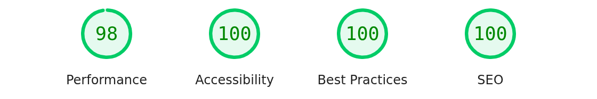 | 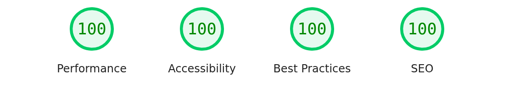 |

| Página | Perfil | Performance | Accessibility | Best Practices | SEO | LCP | TBT | CLS |
| --- | --- | ---: | ---: | ---: | ---: | ---: | ---: | ---: |
| `/` | mobile | 98 | 100 | 100 | 100 | 2,07 s | 146 ms | 0 |
| `/` | desktop | 100 | 100 | 100 | 100 | 0,51 s | 1 ms | 0 |
| `/nft/nft-01` | mobile | 99 | 100 | 100 | 100 | 2,04 s | 77 ms | 0 |
| `/nft/nft-01` | desktop | 100 | 100 | 100 | 100 | 0,49 s | 0 ms | 0 |

Pior caso das 20 execuções no mobile: 96. O script `npm run lighthouse` (build local em HTTPS/HTTP2, 5 execuções) dá números menores quando roda num ambiente lento, como Linux dentro do Windows: lá o início no mobile ficou entre 82 e 90. O motivo, o efeito do service worker do MSW na simulação, o passo a passo das otimizações e os relatórios de cada execução estão em [lighthouse/RESULTADOS.md](./lighthouse/RESULTADOS.md).

## Deploy

Vercel, preset Vite. O `vercel.json` reescreve todas as rotas para `index.html` (acesso direto e refresh funcionam em qualquer tela), serve o `mockServiceWorker.js` sem cache e aplica cabeçalhos de segurança a todas as rotas (CSP, `nosniff`, `frame-ancestors`, `Referrer-Policy`, `Permissions-Policy`, HSTS). A função `api/send-reset-email` não passa pelo rewrite: na Vercel, arquivos e funções têm precedência.

## Além do pedido (extras)

Nada desta seção é exigido pelo enunciado.

- **Painel Kurio Admin** (`/admin`, conta `admin@kurio.test`): visão geral com eventos ao vivo, NFTs e edições (preço, estoque, status, destaque), cupons, pedidos e usuários (somente leitura, e-mail mascarado), busca global (Ctrl+K) e tema claro/escuro. A API confere o papel em toda rota `/api/admin/*` (401/403) e gravações concorrentes recebem 409 com os valores atuais. Detalhes em [ARCHITECTURE.md §13](./ARCHITECTURE.md#13-painel-administrativo-kurio-admin-e-permissão).
- **Tempo real entre abas**: abas do mesmo navegador dividem o estado e os eventos do servidor simulado (Web Locks + `BroadcastChannel`), cada uma recebendo pelo próprio socket. Ver o passo 3 do roteiro e [ARCHITECTURE.md §15](./ARCHITECTURE.md#15-propagação-entre-abas-do-servidor-simulado).
- **Recuperação de senha**: `/recuperar-senha` com resposta neutra, link de uso único válido por 30 min e encerramento das sessões abertas. O e-mail é simulado (link “Abrir e-mail simulado” na tela, ou `__jungleMock.lastEmail('ana@kurio.test')`); além disso, o envio real pelo Brevo via Vercel Function está ligado no site publicado (sem as variáveis, fica só o simulado). Como o "servidor" da demonstração vive no navegador, o link do e-mail real funciona no mesmo navegador em que o pedido foi feito.

  O e-mail segue a identidade do site (cores, fonte mono, campo de senha mascarada) e foi montado para clientes de e-mail: tabelas, estilos inline e botão que funciona mesmo sem CSS externo.

  | Desktop | Celular |
  | --- | --- |
  | 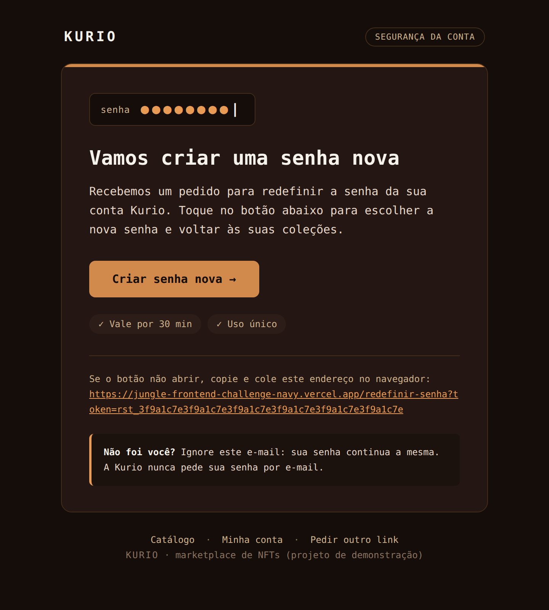 | 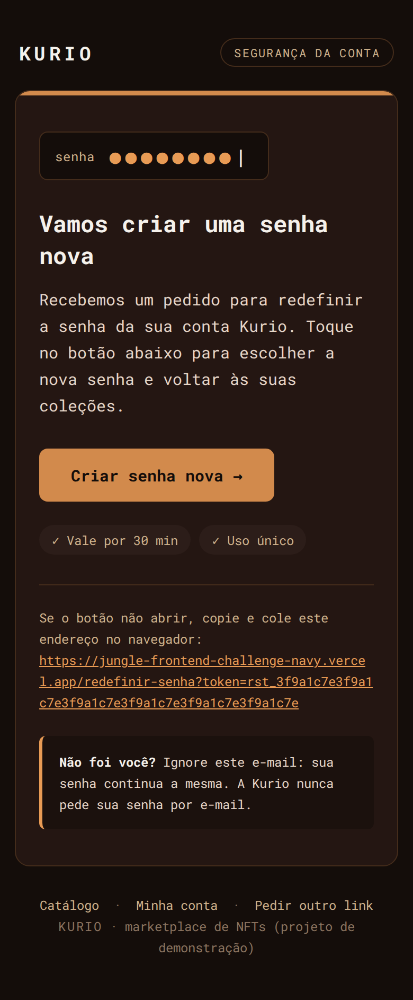 |

- **Filtros ativos e preço digitável**: cada filtro vira uma etiqueta removível, com “Limpar tudo”; a faixa de preço aceita mínimo e máximo digitados, sincronizados com o slider.
- **Busca com sugestões**: até 5 NFTs a partir de 2 letras, navegáveis por teclado.
- **Alerta de preço**: queda de preço de um favorito gera aviso com link e selo “Caiu de …” na lista de favoritos.
- **Histórico de compras** (`/perfil/atividade`): pedidos da conta com número, data, itens, total, rede e status (pendente, confirmado ou recusado com o motivo), link para o recibo; o status muda ao vivo pelo socket e a mudança é anunciada ao leitor de tela.
- **Animações** (GSAP e Lenis), desligadas com `prefers-reduced-motion`. São só realce: nada fica escondido esperando a rolagem (todo o conteúdo aparece desde o primeiro render, inclusive em print de página inteira e na impressão).
- **CI** no GitHub Actions e **testes unitários** (Vitest).
- **Cabeçalhos de segurança** (CSP sem `unsafe-eval`, HSTS e outros), testados em `e2e/19-seguranca.spec.ts`. Ver [SECURITY.md](./SECURITY.md).

## Decisões e trade-offs

- **MSW no navegador, também na demonstração publicada.** O app faz as mesmas chamadas REST e Socket.IO que faria contra um backend real; os mocks sobem antes do app para nenhuma requisição escapar e para o `socket.io-client` já nascer interceptado. Custo: no celular a primeira tela espera o service worker e os mocks (ver Lighthouse).
- **Estado do "servidor" no `localStorage`, com Web Locks e `BroadcastChannel`.** Sustenta refresh e várias abas consistentes (loja e painel admin), com transações para duas abas não sobrescreverem uma à outra. Custo: mais código no mock do que um backend em memória.
- **Servidor é a fonte da verdade nos valores.** Totais, descontos e taxa vêm da API em ETH como string decimal (`decimal.js`); a cotação tem `fingerprint` e o pedido com cotação antiga recebe 409. O cliente só trava a confirmação para o usuário não tentar à toa.
- **Idempotência ponta a ponta.** A chave do pedido é salva antes do envio; timeout, queda ou refresh reenviam a mesma chave e recuperam o mesmo pedido.
- **Tempo real tolerante a falhas.** Dedupe por `eventId`, versão por recurso, pedidos terminais, reconciliação com a REST ao reconectar e filtro por usuário no servidor e no cliente.
- **Contratos zod na borda.** Toda resposta é validada no cliente HTTP, antes de chegar a componente; `jitless` porque a CSP não permite `eval`.
- **Só o layout do tamanho atual é montado.** Desktop e mobile são composições diferentes no Figma; montar só uma reduz trabalho na carga do celular.
- **Extras isolados.** Painel admin, animações e alertas ficam em chunks próprios e não entram na carga da loja.

## O que eu faria com mais tempo

- Pré-renderizar a primeira tela no build, para o conteúdo acima da dobra não depender dos mocks subirem.
- Regressão visual em container (imagem oficial do Playwright), para rodar igual em qualquer sistema.
- Projetos Firefox e WebKit no Playwright para os fluxos principais.
- Backend real (por exemplo NestJS) reaproveitando os mesmos contratos zod, com hash de senha Argon2id no servidor.

## Estrutura

```
src/
  api/          contratos (zod), cliente Axios, endpoints, chaves e opções do TanStack Query
  app/          QueryClient, router, sincronização de sessão
  realtime/     cliente Socket.IO (deduplicação, versões, reconciliação)
  routes/       rotas (TanStack Router, baseadas em arquivo)
  features/     telas por domínio (catalog, nft, cart, checkout, auth, profile, favorites, admin)
  components/   layout, componentes compartilhados e ui/ (shadcn)
  mocks/        servidor simulado: db, handlers REST, Socket.IO, cenários, painel de cenários, fixtures
api/            Vercel Function opcional de envio do e-mail de redefinição
scripts/        teste isolado da função (npm run test:api)
e2e/            testes Playwright e baselines visuais
lighthouse/     script da auditoria, resultados e relatórios
```
